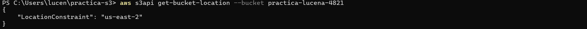
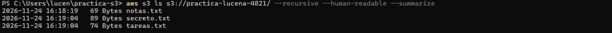
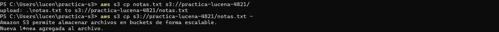
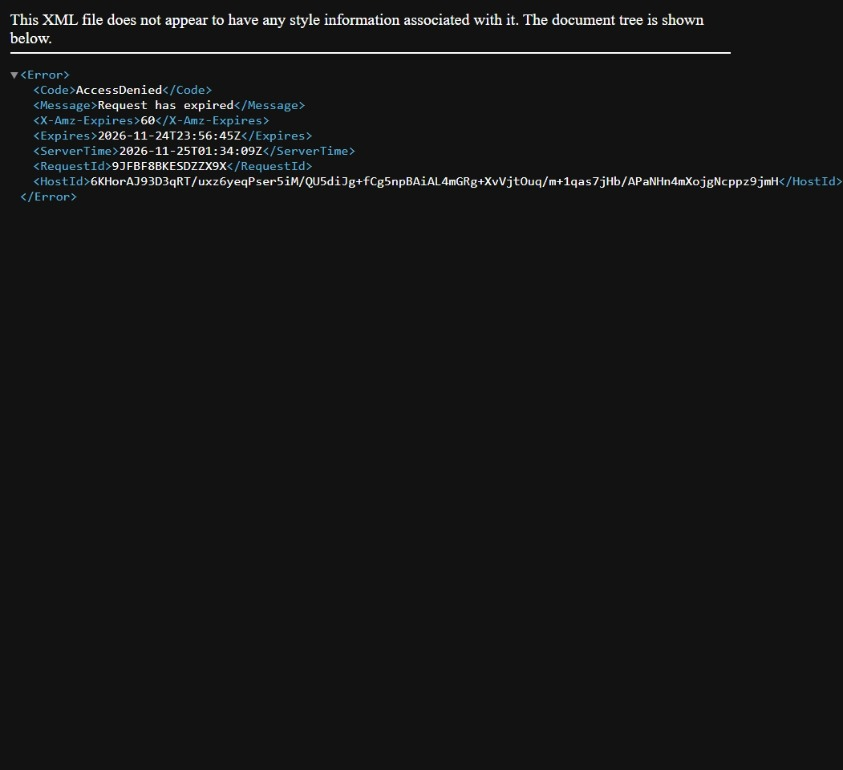
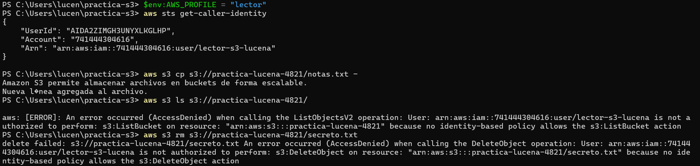
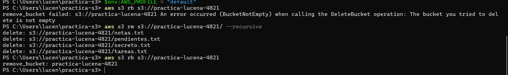
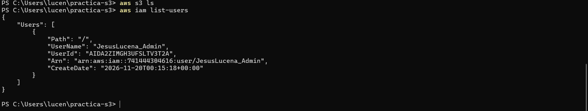

# Evidencia: Ciclo de vida de un bucket en Amazon S3

## 1. Información general

**Objetivo:** Crear, administrar, consultar, modificar y compartir objetos en Amazon S3 mediante AWS CLI, aplicando el principio de menor privilegio con IAM.

| Dato | Valor |
|---|---|
| Servicio | Amazon S3 |
| Región | `us-east-2` |
| Bucket | `practica-lucena-4821` |
| Usuario IAM lector | `lector-s3-lucena` |
| Perfil AWS CLI | `lector` |

---

## 2. Evidencias de ejecución

### Paso 3. Consultar la región del bucket

**Resultado:** Se verificó que el bucket fue creado en la región `us-east-2`.

<!-- INSERTAR IMAGEN DEL PASO 3 AQUÍ -->

### Paso 7. Listar los objetos del bucket

**Resultado:** Se comprobó que el bucket contenía los tres archivos iniciales: `notas.txt`, `tareas.txt` y `secreto.txt`.

<!-- INSERTAR IMAGEN DEL PASO 7 AQUÍ -->

### Paso 13. Verificar la modificación de notas.txt

**Resultado:** Se agregó una nueva línea al archivo local y se volvió a subir al bucket. Al consultar su contenido desde S3, se comprobó que el objeto contenía los cambios realizados.

<!-- INSERTAR IMAGEN DEL PASO 13 AQUÍ -->

### Paso 16. Verificar la expiración del enlace temporal

**Resultado:** Se generó un enlace prefirmado con una duración de 60 segundos. Inicialmente permitió consultar el objeto sin hacer público el bucket. Después de expirar, el enlace dejó de permitir el acceso.

<!-- INSERTAR IMAGEN DEL PASO 16 AQUÍ -->

### Pasos 21, 22 y 23. Validación de permisos del usuario lector

**Resultado:** Se comprobó el funcionamiento de la política de menor privilegio:

- **Paso 21:** El usuario lector pudo consultar el contenido de `notas.txt`, porque tenía permiso `s3:GetObject`.
- **Paso 22:** No pudo listar los objetos del bucket, porque no tenía permiso `s3:ListBucket`.
- **Paso 23:** No pudo eliminar `secreto.txt`, porque no tenía permiso `s3:DeleteObject`.

Los tres resultados se documentan en una sola captura.

<!-- INSERTAR UNA SOLA IMAGEN CON LOS RESULTADOS DE LOS PASOS 21, 22 Y 23 -->

### Paso 24. Intentar eliminar el bucket sin vaciarlo

**Resultado:** AWS rechazó la eliminación porque el bucket todavía contenía objetos. Esto demuestra que primero es necesario eliminar su contenido.

<!-- INSERTAR IMAGEN DEL PASO 24 AQUÍ -->

### Paso 29. Verificar la limpieza de los recursos

**Resultado:** Después de eliminar los objetos, el bucket, la llave de acceso, la política en línea y el usuario IAM de la actividad, se verificó que no quedaran recursos asociados a esta práctica.

<!-- INSERTAR IMAGEN DEL PASO 29 AQUÍ -->

---

## 3. Preguntas de reflexión

### 1. ¿Por qué el nombre de tu bucket tuvo que ser distinto al de tus compañeros si cada uno tiene su propia cuenta?

Esto significa que AWS identifica cada bucket mediante un nombre único en toda la plataforma, independientemente de quién sea el propietario o de la cuenta desde la que se cree.

### 2. El usuario del paso 21 pudo leer un archivo, pero en el paso 22 no pudo ver la lista. ¿Qué acción le faltaba en la política?

Le faltaba el permiso `s3:ListBucket`, que permite consultar los objetos almacenados en un bucket.

La política únicamente tenía `s3:GetObject`, que permite leer el contenido de los objetos cuando se conoce su ubicación.

### 3. En la política, ¿qué significa el `/*` al final del `Resource`? ¿Qué pasaría si se quitara?

El `/*` indica que el permiso se aplica a todos los objetos que están dentro del bucket.

### 4. ¿En qué se diferencia compartir un archivo con un enlace temporal de hacer público el bucket?

Un enlace temporal o prefirmado permite acceder a un objeto específico durante un periodo limitado, utilizando una URL firmada con las credenciales de quien la genera.

En cambio, hacer público un bucket permite que personas sin autorización puedan acceder a los recursos expuestos, según los permisos configurados.

### 5. Según el modelo de responsabilidad compartida, si alguien deja un bucket público con datos de clientes, ¿de quién es la responsabilidad?

La responsabilidad es del cliente o propietario de la cuenta AWS, porque debe configurar correctamente los permisos, proteger los datos y controlar el acceso a sus recursos.

---

## 4. Conclusiones

Durante esta práctica se trabajó con el ciclo de vida de un bucket de Amazon S3 mediante AWS CLI, desde su creación hasta su eliminación.

---

## 5. Consideraciones de seguridad

- No se incluyen claves de acceso ni claves secretas en este documento.
- No se publicaron los objetos del bucket para compartirlos.
- El acceso temporal se realizó mediante una URL prefirmada.
- Se utilizó una política IAM con permisos específicos.
- Se eliminaron los recursos creados para la actividad al finalizar.

**Fin de la evidencia.**